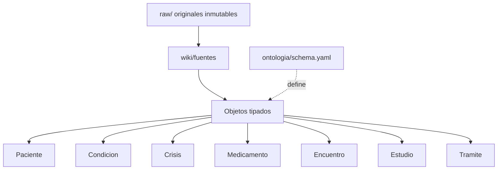

# Ontología médica personal (plantilla)

Plantilla de **wiki clínico** (patrón *LLM Wiki* + ontología estilo Palantir) para organizar la historia de un paciente **en el computador local del cuidador**, con códigos estándar (CIE-10, SNOMED CT, ATC, RxNorm, LOINC) y flujos para un asistente de IA.

> ⚠️ **Privacidad y ética (obligatorio leer).**  
> Este repositorio **no contiene** datos de ningún paciente real: ni nombres, ni fechas clínicas, ni EPS, ni medicamentos prescritos, ni documentos.  
> Es solo la **estructura, el esquema y las plantillas**.  
> La historia clínica real debe vivir **fuera de git** (carpeta local ignorada).  
> El wiki **apoya** al equipo tratante y **no lo sustituye**. Nunca ajustar dosis por cuenta propia. Crisis > 5 min → urgencias.

## Para qué sirve

- Centralizar consultas, estudios, crisis y trámites con la EPS en un grafo navegable.
- Preparar resúmenes para citas y derechos de petición **sin perder la fuente**.
- Dejar listo el frontmatter para Dataview / exportación.

## Arquitectura

## Tipos de objeto

Ver `ontologia/schema.yaml` y `plantillas/`.

| Objeto | Carpeta | Códigos sugeridos |
|---|---|---|
| Paciente | `wiki/paciente/` | — |
| Condicion | `wiki/condiciones/` | CIE-10, SNOMED CT |
| Crisis | `wiki/crisis/` | tipo ILAE / SNOMED |
| Medicamento | `wiki/medicamentos/` | ATC, RxNorm |
| Estudio | `wiki/estudios/` | LOINC (labs) |
| Encuentro | `wiki/encuentros/` | — |
| Persona / Organizacion | `wiki/personas/`, `wiki/organizaciones/` | — |
| Tramite | `wiki/tramites/` | plazos legales CO |
| Evidencia / Fuente | `wiki/evidencia/`, `wiki/fuentes/` | DOI, PMID |

## Cómo usar

1. Clona el repo.
2. Copia `wiki/` a tu vault Obsidian **privado**.
3. Rellena `plantillas/` con datos reales **solo en local**.
4. Añade `raw/` a `.gitignore` (ya está).
5. No hagas `git add` de panoramas ni de páginas de paciente.

## Autor

Juan Esteban Salcedo Moreno. Motivo del diseño: acompañamiento familiar con epilepsia (los datos clínicos **no** se publican).

