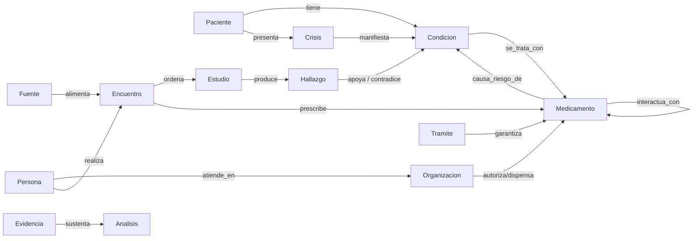

# Ontología del wiki clínico (plantilla) (estilo Palantir)

Modelo de datos que se aplica a todo el wiki. En Palantir Foundry, una ontología define **tipos de objeto** (con propiedades), **tipos de vínculo** entre ellos y **acciones** que modifican el estado. Aquí cada objeto es una página Markdown, las propiedades viven en el frontmatter YAML y los vínculos son wikilinks tipados en una sección `## Vínculos`.

Volver a [[index]] · [[panorama]]

---

## 1. Tipos de objeto

| Objeto | Carpeta | Propiedades clave (frontmatter) | Ejemplo |
|---|---|---|---|
| **Paciente** | `paciente/` | nacimiento, sexo, documento, EPS, residencia, cuidador | `{{ejemplo}}` |
| **Condicion** | `condiciones/` | cie10, snomed_ct, estado, inicio, etiologia, certeza | `{{ejemplo}}` |
| **Crisis** | `crisis/` | fecha, hora, numero_crisis, tipo_ilae_2017, duracion, desencadenante, sueno, medicacion_vigente, fuente, confianza (ver crisis.csv) | `{{ejemplo}}` |
| **Medicamento** | `medicamentos/` | estado (activo/historico/candidato), atc, rxnorm, dosis, dosis_dia_mg, mecanismo, motivo_suspension | `{{ejemplo}}` |
| **Prescripcion** | dentro de Encuentro/Medicamento | fecha, cantidad, duracion_dias, vence, dispensada | ver `{{encuentro_ejemplo}}` |
| **Estudio** | `estudios/` | fecha, modalidad, institucion, lector, resultado, informe_disponible, loinc | `{{ejemplo}}` |
| **Hallazgo** | dentro de Estudio | lateralidad, localizacion, significado | puntas F3/C3 |
| **Encuentro** | `encuentros/` | fecha, tipo (control/urgencias), profesional, IPS | `{{ejemplo}}` |
| **Persona** | `personas/` | rol, especialidad, registro_medico, institucion | `{{ejemplo}}` |
| **Organizacion** | `organizaciones/` | tipo (EPS/IPS/centro), ciudad, NIT, red_eps | `{{ejemplo}}` |
| **Tramite** | `tramites/` | fecha_radicacion, plazo_legal, vence, estado, respuesta | `{{ejemplo}}` |
| **Evidencia** | `evidencia/` | doi, pmid, nivel, año, aplica_a | `{{ejemplo}}` |
| **Fuente** | `fuentes/` | archivo_raw, paginas, fecha_documento, legibilidad | `{{ejemplo}}` |
| **Pregunta** | `analisis/preguntas-proxima-consulta` | prioridad, dirigida_a, estado, respuesta | `{{ejemplo}}` |
| **Accion** | `analisis/plan-de-accion` | responsable, fecha_limite, estado | `{{ejemplo}}` |

## 2. Tipos de vínculo



| Vínculo | De → A | Significado |
|---|---|---|
| `tiene` | Paciente → Condicion | diagnóstico activo o histórico |
| `presenta` | Paciente → Crisis | evento ictal fechado |
| `se_trata_con` | Condicion → Medicamento | indicación terapéutica |
| `interactua_con` | Medicamento ↔ Medicamento | interacción farmacocinética/farmacodinámica (con severidad) |
| `causa_riesgo_de` | Medicamento → Condicion | efecto adverso posible (p. ej., EJEMPLO → hiponatremia, osteopenia) |
| `fallo_previo` | Medicamento → Condicion | ensayo terapéutico fallido (cuenta para farmacorresistencia ILAE) |
| `ordena` / `prescribe` | Encuentro → Estudio / Medicamento | orden clínica |
| `produce` | Estudio → Hallazgo | resultado |
| `apoya` / `contradice` | Hallazgo → Condicion | peso diagnóstico |
| `atiende_en` / `realiza` | Persona → Organizacion / Encuentro | red de atención |
| `garantiza` | Tramite → Medicamento/Servicio | acceso efectivo |
| `sustenta` | Evidencia → Analisis | base científica |
| `alimenta` | Fuente → cualquier objeto | trazabilidad |

## 3. Acciones (cambian el estado del grafo)

| Acción | Efecto en la ontología |
|---|---|
| `registrar_crisis` | crea fila en `{{crisis_ejemplo}}`, recalcula frecuencia mensual en [[panorama]] |
| `iniciar/suspender_medicamento` | cambia `estado` del medicamento, actualiza `{{analisis_ejemplo}}` |
| `registrar_resultado_estudio` | crea Estudio + Hallazgos, cierra orden pendiente |
| `radicar_tramite` | crea Tramite con `plazo_legal` y `vence` calculados |
| `vencimiento` | lint marca prescripciones/autorizaciones/trámites vencidos 🔴 |
| `responder_pregunta` | mueve la pregunta a "respondidas" con la fuente |

## 4. Reglas de integridad
1. Todo **Medicamento activo** debe tener: dosis, fuente de prescripción, fecha de vencimiento de la fórmula y su estado de dispensación.
2. Toda **Crisis** debe tener fecha y fuente (diario, consulta, urgencias).
3. Todo **Estudio ordenado** sin resultado a los 90 días → aparece en `{{analisis_ejemplo}}`.
4. Todo **Tramite** con plazo legal vencido sin respuesta → acción 🔴 en `{{analisis_ejemplo}}`.

## 4. Propiedades de códigos estándar (añadido el 15-10-2026)

Los objetos clínicos llevan códigos de terminologías internacionales en el frontmatter, para cruzar el wiki con la literatura, las fórmulas de la EPS y cualquier historia clínica electrónica. **Solo se escribe un código verificado** en la fuente oficial; si no se pudo verificar, se omite y se deja una propiedad `*_nota` que lo explica.

| Propiedad | Objeto | Terminología | Fuente de verificación |
|---|---|---|---|
| `cie10` | Condicion | CIE-10 de la OMS (versión 2019) | icd.who.int/browse10 |
| `cie10_documentado` / `cie10_sugerido` | Condicion | códigos usados en documentos / propuesta 🧠 | documentos de `raw/` |
| `cie10_cm` | Condicion | CIE-10-CM de EE. UU. (solo si no hay código OMS verificado) | — |
| `snomed_ct` | Condicion (y `snomed_ct_crisis` para el tipo de crisis) | SNOMED CT, edición internacional | servidor terminológico de HL7 (tx.fhir.org), edición 2025-02-01 |
| `atc` | Medicamento | ATC de la OMS | atcddd.fhi.no (WHOCC) |
| `rxnorm` | Medicamento | RxCUI del ingrediente (IN) | NLM RxNav |
| `loinc` | Estudio de laboratorio (mapa analito → código) | LOINC 2.82 | tx.fhir.org / NLM Clinical Tables |
| `codigos_verificados` | todos | fecha de la verificación | — |

Consulta Dataview de ejemplo:
```dataview
TABLE cie10, snomed_ct FROM "condiciones"
```
```dataview
TABLE atc, rxnorm, estado FROM "medicamentos"
```

Datos de crisis en tabla: `{{crisis_ejemplo}}` (`crisis/crisis.csv`). Plazos: `{{analisis_ejemplo}}`.
